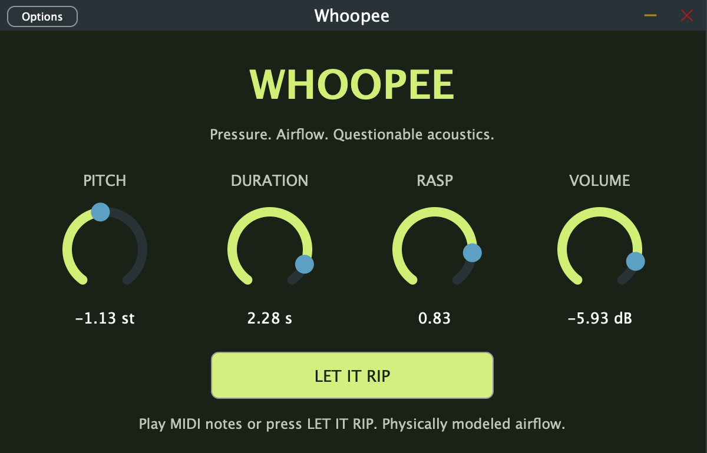

# Whoopee 💨

**A MIDI-playable fart instrument. Yes, really.**

Play it with a MIDI keyboard, put it on a track in your DAW, or open the standalone app and press **LET IT RIP**. Turn up Duration for a longer rip, dial in some Rasp, and pitch it into something deeply unserious.



## Download

**Mac downloads: Apple Silicon (M1 or newer), macOS 14 Sonoma or later.** These builds do not run on Intel Macs or Windows.

| Download | What you get |
| --- | --- |
| [Standalone app — DMG](https://github.com/mattmedlin/whoopee/releases/latest/download/Whoopee-macOS-Apple-Silicon.dmg) | Open the disk image and drag Whoopee into Applications. No DAW needed. |
| [Standalone app — ZIP](https://github.com/mattmedlin/whoopee/releases/latest/download/Whoopee-Standalone-macOS-Apple-Silicon.zip) | Unzip to get `Whoopee.app`. |
| [AU + VST3 plugins — ZIP](https://github.com/mattmedlin/whoopee/releases/latest/download/Whoopee-Plugins-macOS-Apple-Silicon.zip) | Audio Unit for Logic Pro, plus VST3 for compatible hosts. |
| [Complete source — ZIP](https://github.com/mattmedlin/whoopee/releases/latest/download/Whoopee-Source.zip) | Whoopee source and the exact JUCE dependency used to build the release. |

[All releases](https://github.com/mattmedlin/whoopee/releases) · [Source repository](https://github.com/mattmedlin/whoopee)

The Mac builds have a local ad-hoc signature and **are not Apple-notarized**. macOS may block the first launch. For a copy you deliberately downloaded from this repository, follow [Apple’s opening instructions](https://support.apple.com/102445), including Privacy & Security → Open Anyway where offered. If you see “damaged,” download the current release again rather than using an older copy.

## Play it

### Standalone

1. Open **Whoopee.app**.
2. Click **Options** to choose your audio output and enable a connected MIDI keyboard.
3. Play notes—or just press **LET IT RIP**.

### Logic Pro

1. Unzip the plugin download. Copy `Whoopee.component` into `~/Library/Audio/Plug-Ins/Components/`.
2. Restart Logic and create a **Software Instrument** track.
3. In its Instrument slot, choose **AU Instruments → Whoopee Audio → Whoopee → Stereo**.
4. Play a MIDI keyboard, or press **⌘K** for Musical Typing.

If it is missing, check **Logic Pro → Settings → Plug-in Manager**, then **Reset & Rescan Selection**. New Audio Units may need a Mac restart to be discovered. For a VST3 host, copy `Whoopee.vst3` into `~/Library/Audio/Plug-Ins/VST3/` and rescan.

## The knobs

| Control | What it does |
| --- | --- |
| **Pitch** | Transposes the sound by −24 to +24 semitones relative to the MIDI note. |
| **Duration** | Spreads or compresses the contact sequence across 0.08–3 seconds. Applies to the next note. Hold MIDI notes for the full sound. |
| **Rasp** | Smooth and damped at 0, reference tone at 0.55, sharp and gritty at 1. Responds while a note plays. |
| **Volume** | Output level from −48 to 0 dB. |

Eight voices, velocity sensitivity, host automation, and session recall. MIDI note 60 at Pitch 0, Duration 0.8, and Rasp 0.55 plays the reference-fitted tone. Releasing a key fades its voice over 25 ms.

## What makes the noise?

A reference-fitted resonator model: synthesized contact forces excite four damped modes. It does **not** play a recorded sample at runtime. Its close reference match depends on a fitted contact-force sequence, so this is not an autonomous anatomical simulation.

The reference is [“Fart 1” by Breviceps](https://freesound.org/people/Breviceps/sounds/445998/), released under CC0. See [model and decoding details](tools/MODEL.md) and [source provenance](Assets/README.md).

## Build from source

Requires CMake 3.22+, Git, and a C++17 compiler. Use Xcode Command Line Tools on macOS or Visual Studio 2022 with C++ on Windows. CMake downloads JUCE 8.0.6 on first configuration.

```sh
cmake -S . -B build -DCMAKE_BUILD_TYPE=Release
cmake --build build --config Release --parallel 2
ctest --test-dir build -C Release --output-on-failure
```

Outputs are in `build/Whoopee_artefacts/Release/`: `Standalone`, `VST3`, and, on macOS, `AU`. Windows source builds produce `Whoopee.exe` and VST3. This release's prebuilt downloads are Mac-only.

For the complete source ZIP, add `-DFETCHCONTENT_SOURCE_DIR_JUCE=vendor/JUCE` to the configure command to use its bundled dependency.

DSP-only checks without JUCE:

```sh
cmake -S . -B build/dsp -DWHOOPEE_BUILD_PLUGIN=OFF
cmake --build build/dsp
ctest --test-dir build/dsp --output-on-failure
```

CI builds on macOS and Windows. Local checks cover DSP stability, Duration, live Rasp changes, and reference-waveform fidelity. Host compatibility still depends on your DAW and system.

## License

Whoopee's own source is [Apache-2.0](LICENSE). The distributed applications/plugins include JUCE under [AGPL-3.0](LICENSES/AGPL-3.0.txt); the complete corresponding source download includes JUCE and its dependency notices. See [third-party licensing](LICENSES/JUCE.md). The reference recording is CC0.
